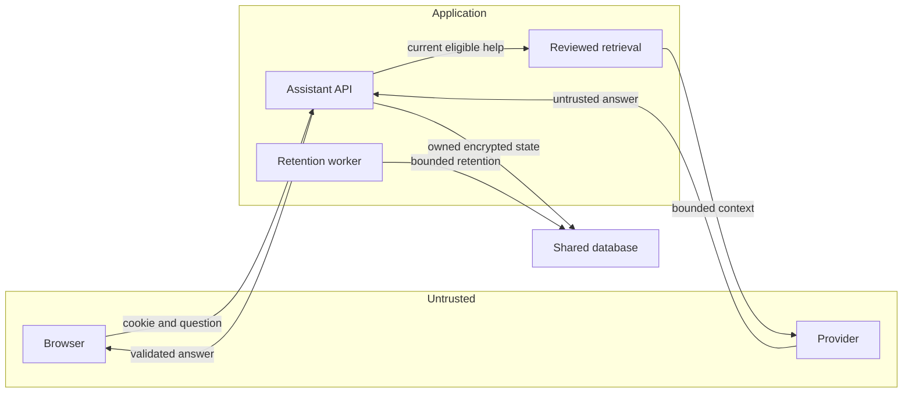

## Executive summary

This is the W7 threat-model baseline; W8 verification updates are recorded under
Notes on use. The highest residual risks are restricted guidance surviving an access transition,
unreviewed text reaching the provider, anonymous cost abuse and model claims that
exceed reviewed evidence. W7 adds shared ownership, encrypted transient state,
atomic quotas and final access checks; UI integration, real-provider evaluation,
operational monitoring and reviewed human handoff remain release gates. AI is
disabled by default. This is a source-grounded local review, not hosted acceptance.

## Scope and assumptions

Scope: `backend/src/modules/learning`, its authentication/workforce/CSRF/security
dependencies, configuration, worker retention and API forwarding. Frontend current
learning access invalidation is a dependency; the new conversational UI is unfinished.
Payments, media processing and unrelated operational services are outside this model.

The owner answered **“I'm not sure”** to deployment/data-scope clarification on
27 October 2026. Assume an internet-facing site with anonymous and signed-in users,
possibly multiple backend instances. Exact deployed instance count, outbound network
policy and provider-account retention privileges remain unknown. Private business
records/support threads are excluded from model input by implementation scope.
These assumptions increase abuse/isolation priority; they do not verify hosting.
Real chat and Customer Care handoff require a later extension of this model.

## System model

### Primary components

Next same-origin API rewrite; Express assistant routes; current authenticated
learning/workforce resolver; shared PostgreSQL conversation/quota state; bounded
reviewed retrieval and Responses adapter; existing general retention worker.
CI uses isolated synthetic databases and stubbed provider responses, separately
from runtime. The Windows setup helper stores a DPAPI-protected evaluation key
outside the repository and makes no request.

### Data flows and trust boundaries

- Browser → API over HTTPS in deployment: opaque cookies, typed question, page enum,
  UUID operation and version. Strict schema, trusted Origin, guest/account CSRF,
  ownership and current session/MFA/permission checks; private/no-store responses
  (`allie.routes.ts`, `allie.schemas.ts`). Production HTTPS is a deployment condition.
- API → PostgreSQL: HMAC owner/risk keys, leases/quotas, encrypted bounded transcript
  and usage metadata. Shared advisory lock, actor/session locks and final CAS protect
  claims; DB TLS/least privilege follow existing deployment configuration
  (`allie.conversations.ts`, `learning.service.ts`). The local test connection is
  isolated loopback without TLS, not evidence of hosted TLS.
- Reviewed catalogue/question → provider HTTPS: bounded eligible help/context and
  screened deliberately typed text. Fixed host/path, strict structured output,
  `store:false`, no tools/retries, time/byte/output caps. Key stays server-side
  (`allie.provider.ts`, `allie.retrieval.ts`). Account abuse-monitoring retention
  remains distinct from application state.
- Provider → API → browser: untrusted text/IDs, no reasoning. Runtime validation,
  plain text, registered eligible source/action metadata and fresh current-access
  checks before finalization (`allie.safety.ts`, `allie.answer.ts`). Semantic factual
  grounding still requires evaluated evidence; schema alone cannot establish it.
- Worker → PostgreSQL: bounded deletion restricted to assistant state/metadata;
  logical expiry denies reads even before worker runs (`allie.retention.ts`).
  Backup retention and worker health remain operational dependencies.
- Runtime → logs/metrics: safe errors and redacted question/history/envelope paths
  (`common/security/redaction.ts`); alerting and deployed sink configuration need
  operational verification. No raw provider error body is returned.

#### Diagram

## Assets and security objectives

| Asset                                        | Why it matters                                           | Security objective (C/I/A) |
| -------------------------------------------- | -------------------------------------------------------- | -------------------------- |
| Restricted guidance and help transcripts     | Role privacy and potentially sensitive typed text        | C, I                       |
| Session, CSRF, provider/encryption keys      | Account authority and external spend                     | C, I                       |
| Canonical reviewed knowledge/action registry | Accurate advice and permitted navigation                 | I                          |
| Shared quota and operation state             | Replay safety, cost and availability                     | I, A                       |
| Business/support records                     | No accidental AI mutation or restricted forwarding       | C, I                       |
| Logs/backups                                 | Retention accuracy without credential/transcript leakage | C, I, A                    |

## Attacker model

### Capabilities

An unauthenticated attacker can create guest sessions, send crafted questions and
IDs, race/replay requests and rotate addresses. An authenticated attacker can use
their permitted account, lose assignments mid-turn and attempt another conversation
ID. An untrusted question or future knowledge edit can contain prompt injection.
The provider can return malformed, false or adversarial output.

### Non-capabilities

Do not assume database credentials, server execution, key access, an owner account
or approved independent-review authority. Allie has no operational tools. Browser
IDs/context are not authority. Transport/TLS compromise and malicious local-user
software are outside the remote-attacker assumption, but key handling is still noted.

## Entry points and attack surfaces

| Surface              | How reached                                           | Trust boundary       | Notes                                                             | Evidence (repo path / symbol)                    |
| -------------------- | ----------------------------------------------------- | -------------------- | ----------------------------------------------------------------- | ------------------------------------------------ |
| Guest bootstrap      | POST public assistant/session                         | Browser/API          | Trusted Origin; shared IP issue limit                             | `allie.routes.ts`, `bootstrapAllieGuest`         |
| Owned state          | Both namespaces, conversations create/list/read/clear | Browser/API/DB       | Account session or guest proof; strict inputs; separate histories | `allie.conversations.ts`, `material`             |
| Turn and cancel      | POST owned conversation turns/cancel                  | Browser/API/provider | CSRF, version/operation, quotas and current finalization          | `submitAllieTurn`, `cancelAllieTurn`             |
| Content/retrieval    | Server-owned learning registry                        | Content/provider     | Eligibility before retrieval and after generation                 | `allie.retrieval.ts`, `learning.service.ts`      |
| Structured response  | Fixed Responses HTTP endpoint                         | Provider/API         | Byte/time caps, safe parsing, allowed citations/actions           | `allie.provider.ts`, `allie.safety.ts`           |
| Retention and logs   | General worker and request logging                    | API/worker/DB/sink   | Bounded assistant-only erasure; redaction                         | `allie.retention.ts`, `redaction.ts`             |
| Evaluation key setup | Owner's local terminal                                | Local user/files     | DPAPI encrypted, no overwrite or request; not web-exposed         | `backend/scripts/configure-allie-evaluation.ps1` |

## Top abuse paths

1. Guess another UUID → replay a read/turn → seek cross-account transcript. Owner,
   session and audience predicates must fail before content is returned.
2. Begin a staff answer → revoke/expire assignment → receive old restricted answer.
   Current resolver/source checks, cancellation and atomic finalization reject it;
   the unfinished conversation UI must also discard stale output.
3. Inject a question/source → demand forged links or successful transaction claims →
   mislead a customer. No tools and validated registered IDs contain actions, but
   plausible unsupported prose needs adversarial model evaluation.
4. Rotate guest identities → race turns across replicas → exhaust spend/availability.
   Shared IP/owner/concurrency/daily reservations limit admissions; distributed
   addresses and low-cost legitimate-service denial remain possible.
5. Paste a secret → miss heuristic detection → transmit it to the provider. Explicit
   privacy notice, bounded context and screening reduce exposure; they cannot promise
   perfect redaction. Private-record capture must remain excluded.
6. Cancel/clear while generation runs → late completion rewrites cleared history.
   Shared status, version checks and ownership finalization prevent persistence;
   upstream cancellation may still incur cost.
7. Stop the worker or copy logs/backups → retain transcripts beyond UI expiry.
   Immediate logical denial and encrypted payloads help; worker alerts, backup policy
   and deployed redaction verification remain required.

## Threat model table

| Threat ID | Threat source                      | Prerequisites                            | Threat action                                        | Impact                                   | Impacted assets          | Existing controls (evidence)                                                                                       | Gaps                                                | Recommended mitigations                                                                          | Detection ideas                                            | Likelihood                            | Impact severity                                   | Priority |
| --------- | ---------------------------------- | ---------------------------------------- | ---------------------------------------------------- | ---------------------------------------- | ------------------------ | ------------------------------------------------------------------------------------------------------------------ | --------------------------------------------------- | ------------------------------------------------------------------------------------------------ | ---------------------------------------------------------- | ------------------------------------- | ------------------------------------------------- | -------- |
| TM-001    | Other guest/account                | Valid own session or guessed ID          | Cross-owner read/replay                              | Restricted transcript disclosure         | Help/history             | HMAC session ownership, current resolver, strict schemas (`allie.conversations.ts`)                                | Hosted cookies/UI not accepted                      | Verify cookie forwarding and browser account-switch disposal                                     | Aggregate ownership denials without IDs/text               | low: native isolation cases pass      | high: restricted guidance could leak              | medium   |
| TM-002    | Revoked workforce user             | Turn already running                     | Race revocation against completion                   | Old authority retained in answer/history | Guidance/session         | Existing actor locks, shared status, final current access/source checks (`learning.service.ts`, `submitAllieTurn`) | Conversation UI and true replica acceptance pending | Connect W5 invalidation to Allie; run two-replica expiry/revocation cases                        | Count access-changed cancellation and completion conflicts | medium: real transition race          | high: confidential work context                   | high     |
| TM-003    | Question/source injection or model | Eligible source or typed prompt          | Forge claims/citations/actions                       | False advice or unsafe navigation        | Knowledge/business truth | No tools; plain text and registered ID checks (`allie.safety.ts`)                                                  | Schema cannot prove factual grounding               | >=100 reviewed/adversarial real-provider cases, manual unsupported-claim review                  | Safe failure/unsupported-answer counts                     | medium: model input is untrusted      | high: false fitment/payment or operation claims   | high     |
| TM-004    | Distributed anonymous caller       | Public AI enabled                        | Rotate sessions/addresses and race                   | Cost or loss of help availability        | Quotas/compute           | Shared mutex, IP/owner limits, leases, 32k reservation (`allie.conversations.ts`)                                  | No actual cost/latency or deployed proxy proof      | Verify trusted proxy, project hard cap, bounded evaluation and edge controls if needed           | Failure/quota/lease/usage aggregates, abnormal-rate alerts | medium: internet exposure assumed     | medium: bounded spend but service denial possible | medium   |
| TM-005    | User error or malicious prompt     | User types sensitive text                | Evade screening or request private capture           | External sensitive processing            | Keys/typed text          | Secret screening, strict page enum, no record inputs (`allie.safety.ts`, `allie.schemas.ts`)                       | Notice/UI and account data policy unverified        | Accurate pre-send notice, provider controls review, redaction tests; never collect forms/threads | Safe blocked-input count without text                      | medium: screening is heuristic        | high: secrets may be sensitive                    | high     |
| TM-006    | Cancelling/replaying caller        | Own live operation                       | Late-save after clear/cancel or duplicate generation | Stale state and duplicate cost           | Operations/history       | Shared CAS, idempotency, version/lease and cancellation (`submitAllieTurn`)                                        | Real disconnect/replica acceptance pending          | Browser interrupted-operation reconciliation with no blind resend                                | Cancellation/lease/replay aggregates                       | low: native concurrent cases pass     | medium: bounded history/cost impact               | low      |
| TM-007    | Operator failure or log reader     | Worker unavailable or sink/backup access | Retain/recover expired text                          | Retention/disclosure mismatch            | Logs/backups/history     | Purpose-separated GCM, TTL read denial, worker erasure, log redaction (`allie.storage.ts`, `allie.retention.ts`)   | Hosted worker/sink/backup controls unverified       | Alert on retention heartbeat/backlog; verify sink and backup policy before exposure              | Assistant-retention heartbeat, aggregate oldest backlog    | medium: operational failure plausible | high: typed text confidentiality                  | high     |

## Criticality calibration

- **critical:** unauthenticated broad transcript export, or provider input gaining
  unrestricted business mutation authority. Neither was established in this review.
- **high:** stale restricted work answers after revocation, repeated secret disclosure
  to the provider, or confident fabricated safety/payment instructions.
- **medium:** bounded anonymous spend exhaustion, isolated ownership regression behind
  currently tested controls, or resource-denial affecting AI with reviewed help intact.
- **low:** rejected malformed questions, expired operation conflict requiring review,
  or cancelled work that consumes bounded already-admitted usage.

## Focus paths for security review

| Path                                                  | Why it matters                                                         | Related Threat IDs             |
| ----------------------------------------------------- | ---------------------------------------------------------------------- | ------------------------------ |
| `backend/src/modules/learning/allie.conversations.ts` | Shared lock ordering, ownership, quotas, cancellation and finalization | TM-001, TM-002, TM-004, TM-006 |
| `backend/src/modules/learning/learning.service.ts`    | Actual current role/MFA/session/capability eligibility                 | TM-001, TM-002                 |
| `backend/src/modules/learning/allie.routes.ts`        | Cookie, Origin, CSRF and safe errors                                   | TM-001, TM-004, TM-005         |
| `backend/src/modules/learning/allie.retrieval.ts`     | Permission-first content and complete bounded restrictions             | TM-002, TM-003                 |
| `backend/src/modules/learning/allie.provider.ts`      | Fixed egress, request shape, caps and untrusted response handling      | TM-003, TM-004, TM-005         |
| `backend/src/modules/learning/allie.safety.ts`        | Secret screening and registered source/action validation               | TM-003, TM-005                 |
| `backend/src/modules/learning/allie.storage.ts`       | Envelope and binding integrity                                         | TM-001, TM-007                 |
| `backend/src/modules/learning/allie.retention.ts`     | Bounded physical erasure independent of feature enablement             | TM-007                         |
| `backend/src/common/security/redaction.ts`            | Prevent typed questions/envelopes reaching logs                        | TM-005, TM-007                 |
| `frontend/app/components/learning`                    | Pending conversation UI must respect current access and consent        | TM-002, TM-005, TM-006         |

## Notes on use

Reviewed against W7 local source on 27 October 2026. Native cases use actual HTTP,
current authenticated resolver and synthetic PostgreSQL, with mocked provider output.
No configured-provider quality, real deployment topology or hosted security claim.

W8 update: conversation controls now integrate current-catalogue disposal, request
abort/unmount, explicit send/clear, safe current links, uncertain-result checks and
provider/privacy notices. Sixteen intercepted browser cases and 37 native
provider-mocked cases passed in separate evidence layers. The baseline's pending UI
implementation items have advanced to combined real backend/provider and hosted
acceptance gates. No real model call, account data-control verification or release.
Review also identified a guest-row/advisory-lock ordering scenario in retention;
targeted reproduction is required before exposure. See `ALLIE_CONVERSATION_UI_W8.md`.

- Covered guest bootstrap, both namespaces' state/turn/cancel routes, content/provider,
  retention/logging and local evaluation setup; no new upload or operational tool.
- Every identified boundary appears in an abuse path/table; runtime and CI/local
  setup are distinguished.
- Owner uncertainty is recorded; instance count, account data controls, proxy/TLS,
  worker/backup/sink monitoring and actual evaluation remain open release questions.
- Extend this review when the conversation UI, canonical handoff and live transport
  are implemented. This report does not authorize exposure or publication.

## W9 configured-provider and lock-order review (27 October 2026)

W9 closes the identified guest-retention wait with parameterized, bounded
`FOR UPDATE SKIP LOCKED`; a held guest row is skipped and retired after release.
The original failure and final native 39-case regression are retained. No table,
permission or schema change was required. Logical expiry continues to deny reads.

Actual provider evaluation included 100 baseline questions and twelve targeted
rechecks, plus ten local pre-provider negatives. Engineering review found a managed
internal-note recommendation, generic public Contact recovery for internal work,
imprecise assigned-only sales guidance, two retrieval misses and missing-guide/draft
wording gaps. The source/projection/prompt fixes and case-level results are recorded
in ALLIE_EVALUATION_W9.md and ALLIE_EVALUATION_REVIEW_W9.json. No actual internal note
or customer record was retrieved, and no model mutation capability was introduced.
The baseline's 25 quality issues are not hidden by 100 structurally valid responses;
the final implementation received representative rechecks, not a second full run.

The model now receives only coarse server-derived audience/release mode alongside
the bounded eligible source/actions and recent help history. Scope descriptions are
normalised from current capabilities; no user, branch or record IDs are added to
model input. This metadata assists explanation and never substitutes for server
authorization. Current source-set changes still invalidate saved context.

The owner configured the dedicated evaluation key through current-user DPAPI. Key
material passes to a local child through stdin, never arguments/logs. The cumulative
exclusive-lock ledger reserved usage before egress and retained failed/unused
reservations. Its 120-request limit is exhausted (117 completed calls). Do not reset
it to obtain more calls. Receipt output text is synthetic test evidence outside Git;
production request diagnostics still exclude complete prompts/transcripts.

Actual guest/customer browser-to-API-to-isolated-DB-to-provider flows, saved readback,
native-dialog Axe and 390/1440 screenshots advance TM-001/003/005/006 evidence. They
do not establish real workforce browser acceptance, hosted proxy/cookie controls,
two-replica operation, provider special retention, production worker/backup/log
monitoring or human takeover. Test harness errors (envelope, native-dialog selector
and protected CSRF refresh allowance) were corrected without changing runtime
security. Existing synthetic API processes/locks were retired; the frontend preview
and database receipts remain. No publication or default AI enablement occurred.

Canonical reviewed handoff and shared staffed transport introduce new persistence,
audience and subscription boundaries; extend this review before accepting them.

## W12 scoped appointment confirmation boundary

The new managed-workforce confirmation route intersects current BOOKINGS_READ
record scope with a separately active BOOKING_CONFIRM grant. Position, account
tier and a grant alone cannot expose another branch. Transactional workforce and
actor locks serialize authority changes; current scope is rechecked after business
locks before commit, so time-based expiry rolls back transactional side effects.
The existing legacy transition core continues to enforce approved capacity/calendar,
assigned staff/duration, schedule conflict, expected version, audit and reminders.
No payment execution, broad legacy endpoint access or new delegation is introduced.

The browser reviews current facts and an editable resource-check note before sending.
Its session marker contains only an actor-keyed booking reference/version/token,
never the note. Access/session invalidation redacts that reference and discards
protected reads/reviews. An unverified/lost response cannot be automatically retried;
fresh record inspection does not pretend to identify which request committed.
Recovery codes select static reviewed copy; arbitrary server validation text remains
filtered. Native branch/revocation/concurrency tests and isolated browser fixtures,
plus an actual browser/API/restricted-CI-DB confirmation, provide local evidence.
The appointment reminder is scheduled, not verified delivered. No actual provider
call or operational customer record is involved. The gated help topic has no fresh
real-provider evaluation under the exhausted W9 allowance. Hosted, device and complete
route learning acceptance remain separate gates; this does not authorize release.

## W13 scoped financial aftercare boundary

Current FINANCE_READ branch scope intersects a separate active FINANCE_POLICY_APPROVE
duty. Position, grant alone and enrolled Admin status cannot expose foreign orders.
The projection excludes customer identity/contact, full order data and raw policy
settings. A purpose-separated server HMAC binds request/items/financial/policy evidence,
including unprojected settings, without exposing a guessable unkeyed digest of them.
The revision proves freshness only; every read/decision rechecks authority and scope.
Request/order locks serialize the decision and existing business checks/audit handling.
Unknown JSON evidence stays unknown and cannot confer financial decision authority.
Database immutable-pricing and kind/status guards remain intact and were exercised.

The UI keeps internal inspection evidence separate from the explicitly customer-visible
decision note. It never auto-copies internal notes, pays a refund, restocks goods or
sends model output to customers. Session-local uncertainty stores only an actor-keyed
request reference/token; invalidation redacts that reference and disposes the review.
An ambiguous response stays blocked through reload, with explicit current-state/history
inspection that cannot attribute an earlier operation. The new help source is static,
permission-gated and contains no operational record retrieval for the provider.

Final62 native tests,21 responsive fixtures and a real browser/CSRF/API/restricted-CI-DB
decision provide bounded local evidence. No actual provider call, customer message or
public feature enablement occurred. The new guidance has no fresh real-provider review
under W9's exhausted allowance. Hosted proxy/role/device acceptance and all-route
learning remain open; persisted handoff and live transport still need their own review.

## W14A branch contact and read-time expiry

A Care permission in one branch cannot expose structured customer contact in
another branch accessed through assigned Sales work. Projection strips raw fields;
frontend rejects invalid contact-bearing responses. Detail scope is checked before
and after its parent record lock, then before final projection; list scope is
refreshed after query/audit work. Six restricted-CI HTTP/DB tests include both
real lock-wait expiry outcomes, plus13 parser and8 rendered fixture cases.
Production prevalence was not inspected. No new authority or public feature.
